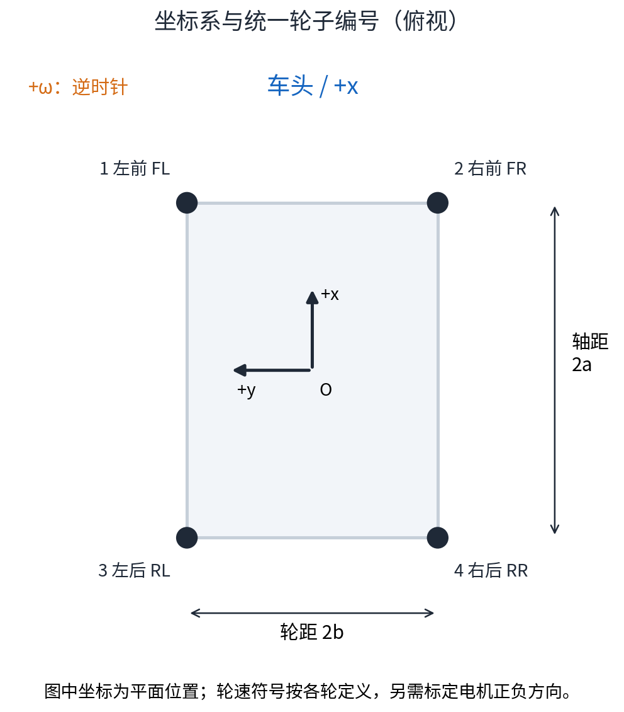
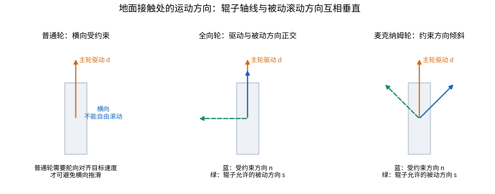
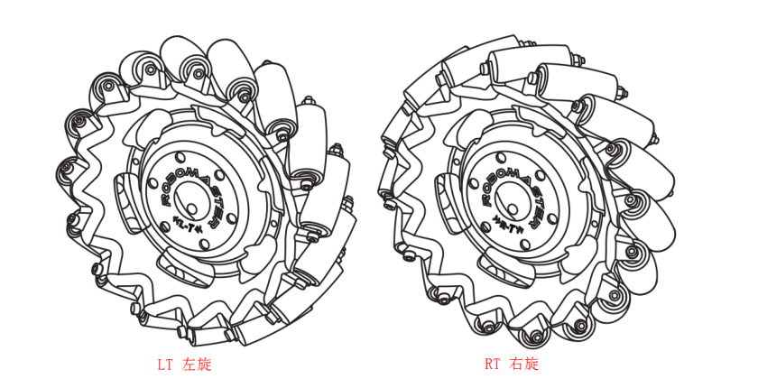
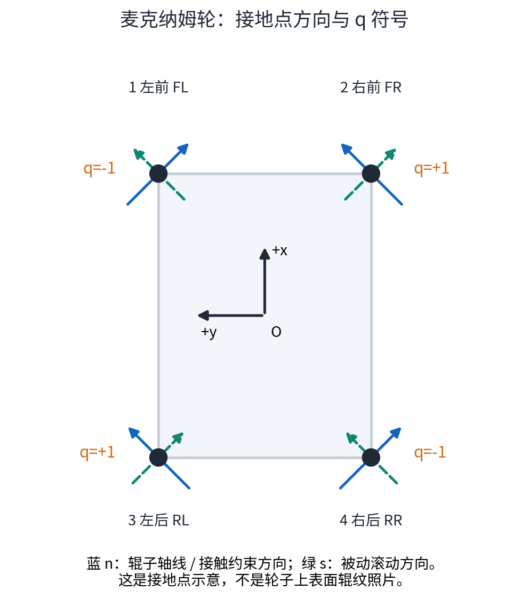
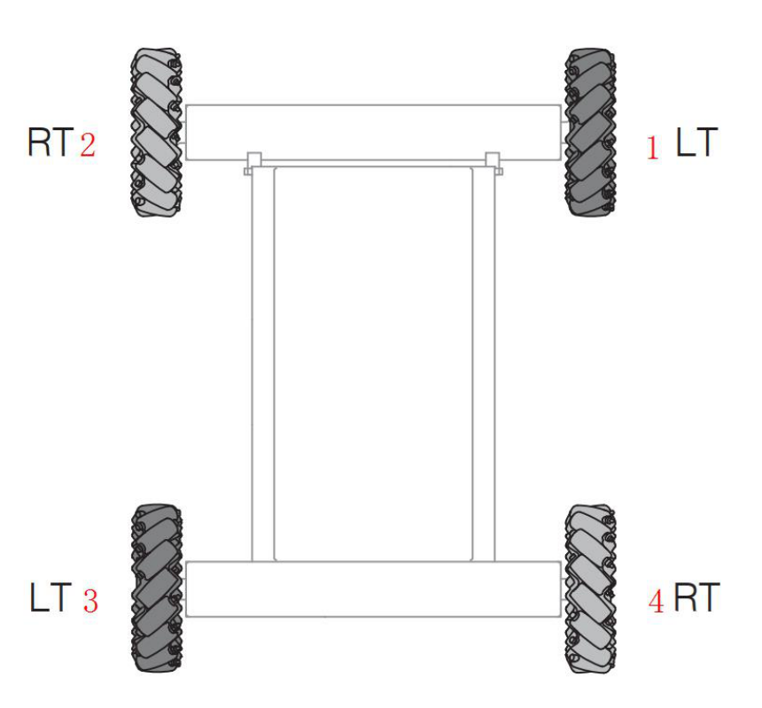
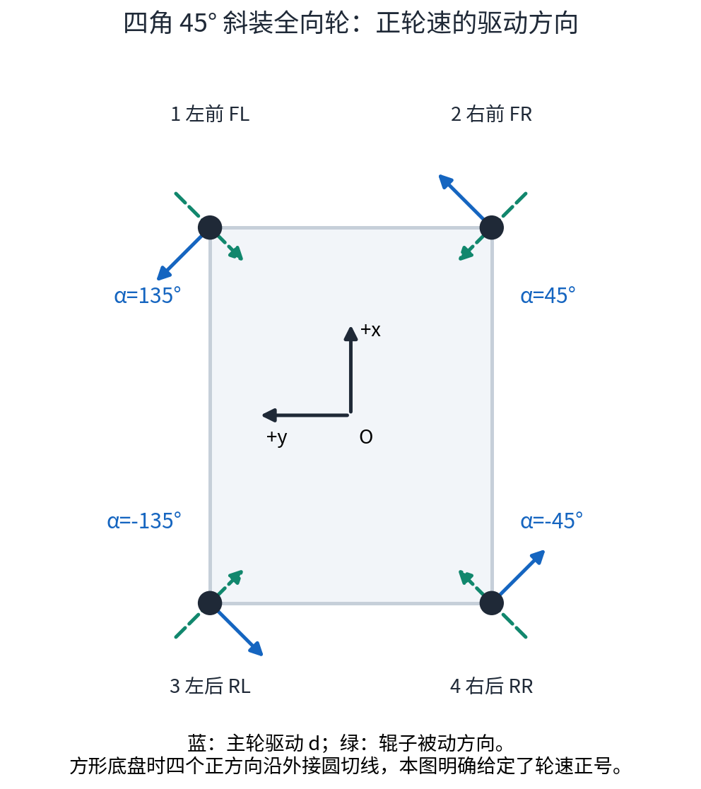
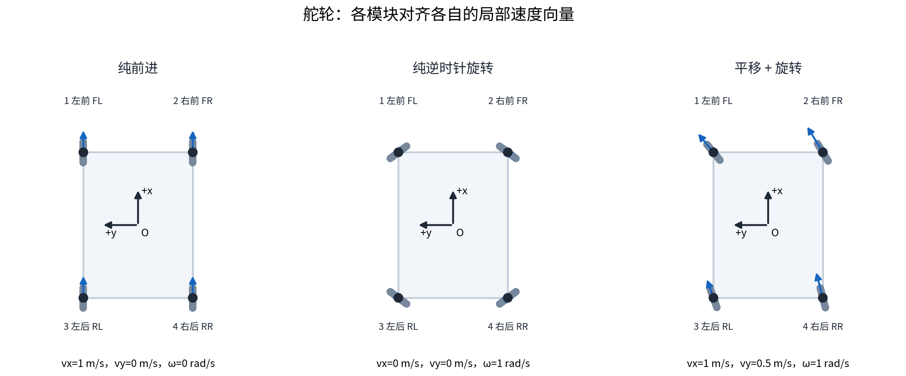
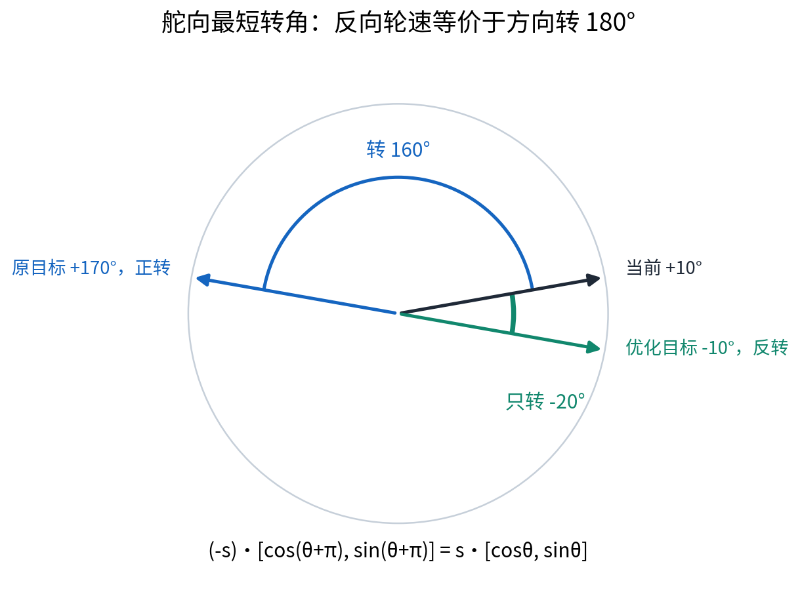

# 麦克纳姆轮、全向轮与舵轮：底盘解算的原理、推导和学习理解

> 学习任务：从底盘期望速度 $v_x,v_y,v_w$ 推导各轮的驱动线速度；对舵轮，同时求舵向角。本文采用 $\omega=v_w$，单位 rad/s。所有推导都是理想平面运动学，不包含电流、力矩、轮胎弹性和实际打滑的动力学模型。
>
> 阅读基础：上传的《RoboMaster开发板C型嵌入式软件教程文档》第 17 章，重点是 PDF/印刷页 241～244、254～257；全向轮及舵轮补充参阅文末的一手资料。本文的公式按统一约定重新推导，示例尺寸用于学习，不代表你的实体底盘。

## 1. 先明确我们要求什么

遥控器或上层控制器给出三个运动目标：向前速度 $v_x$、向左速度 $v_y$、逆时针角速度 $\omega$。底盘解算要把这三个目标转换为电机控制环能够跟踪的目标：

| 底盘类型 | 每个轮组的输出 | 调整方向的方式 |
|---|---|---|
| 麦克纳姆轮 | 主轮驱动线速度 $u_i$ | 斜置辊子配合各轮差速，无主动舵向 |
| 普通全向轮 | 主轮驱动线速度 $u_i$ | 辊子允许侧向运动，主轮按不同方位固定安装 |
| 舵轮 | 驱动线速度 $s_i$ 和舵向角 $\theta_i$ | 舵向电机转轮组，驱动电机使轮子滚动 |

这里的“轮子线速度”指主轮转速乘有效半径，即 $u_i=r_i\dot\phi_i$；**对于带被动辊子的轮子，它不一定等于轮组位置相对地面的速度大小。** 舵轮在方向完全对齐时，驱动线速度才等于该局部速度的模长。

通常将“底盘速度 → 各轮目标”叫**逆运动学**，将“各轮反馈 → 底盘速度”叫正运动学。教材把前一种过程称为“底盘正运动过程”；阅读时要看实际输入输出，避免只根据术语判断。

### 1.1 坐标、编号和单位

坐标系固定在车体上：$+x$ 指向车头，$+y$ 指向左侧，$+z$ 向上；绕 $+z$ 的逆时针旋转为正。$a$ 是半轴距，$b$ 是半轮距，$r$ 是主轮有效半径，均以 m 为单位。轴距指前后轮位置间距，轮距指左右轮位置间距。

| 本文编号 | 名称 | 轮组位置 $(x_i,y_i)$ | 教材第 243 页编号* |
|---|---|---|---|
| 1 | 左前 FL | $(a,b)$ | 2 |
| 2 | 右前 FR | $(a,-b)$ | 1 |
| 3 | 左后 RL | $(-a,b)$ | 3 |
| 4 | 右后 RR | $(-a,-b)$ | 4 |

\*按教材安装图顶部为前部理解，与第 244 页的运动符号表核对一致。本文在后文也给出教材顺序的完整公式。编号不等于 CAN ID，实际映射应另填表。

- $v_x,v_y,u_i,s_i$：m/s。
- $\omega,\dot\phi_i$：rad/s，分别是底盘和主轮角速度，不能混用。
- $\theta_i,\alpha_i$：rad；为便于阅读，安装角和示例结果也会写成 °。
- 电机 rpm、转子 rad/s、减速后输出轴 rad/s 是不同量，接入速度环前必须统一。

### 1.2 理想模型的前提

假设底盘是刚体，地面平整，各轮稳定接触；驱动约束方向没有打滑，辊子能在被动方向低阻力滚动。轮径、位置与方向已知。舵轮暂时忽略舵轴偏置和转向/驱动机械耦合，并把舵轴与接地点的水平投影视为重合。

这些假设用来建立目标速度关系，不意味着真车完全满足。尤其是舵轮有转向时间，不能在轮子尚未对齐时瞬间实现任意新方向。

## 2. 三种底盘共同的起点：求轮组位置的局部速度

### 2.1 刚体上各点的速度为什么不同

车体纯平移时，所有轮组位置速度相同。车体纯旋转时，每个轮组绕参考点运动，方向是圆的切线，大小与到参考点的距离成正比。两种运动可以在线速度层面叠加：

$$
\mathbf v_i=\mathbf v_O+\boldsymbol\omega\times\mathbf r_i
$$

其中

$$
\mathbf v_O=\begin{bmatrix}v_x\\v_y\\0\end{bmatrix},\quad
\boldsymbol\omega=\begin{bmatrix}0\\0\\\omega\end{bmatrix},\quad
\mathbf r_i=\begin{bmatrix}x_i\\y_i\\0\end{bmatrix}.
$$

按叉乘展开：

$$
\boldsymbol\omega\times\mathbf r_i
=\begin{bmatrix}-\omega y_i\\\omega x_i\\0\end{bmatrix}.
$$

因此定义轮组所在点的两个速度分量 $U_i,V_i$：

$$
\boxed{U_i=v_x-\omega y_i,\qquad V_i=v_y+\omega x_i}
$$

这一步只与刚体位置有关，还没有用到任何轮子的结构。WPILib 舵轮实现中的每组 $2\times3$ 矩阵也是这一关系，可用于独立核对符号。[6]

代入四个位置：

| 轮组 | $U_i$：向前分量 | $V_i$：向左分量 |
|---|---|---|
| FL | $v_x-b\omega$ | $v_y+a\omega$ |
| FR | $v_x+b\omega$ | $v_y+a\omega$ |
| RL | $v_x-b\omega$ | $v_y-a\omega$ |
| RR | $v_x+b\omega$ | $v_y-a\omega$ |

**符号自检：**纯逆时针旋转时，左前轮位置向后且向左，因此 $U_1=-b\omega,V_1=a\omega$。如果它算成向前且向右，坐标或旋转符号一定有问题。

### 2.2 一个重要理解：刚体相同，不等于各点速度相同

$v_x,v_y$ 是参考点 $O$ 的平移速度分量。发生旋转时，轮组位置速度还要加上 $(-\omega y_i,\omega x_i)$。不能先求车体中心速度的模长，然后让四个轮子都以这个速度转动。

## 3. 辊子为什么能让轮子横着走

### 3.1 普通轮与辊子轮的差异

普通轮由主轮绕轮轴转动实现前后滚动；横向移动通常会发生拖滑。全向轮在轮缘安装可自由转动的小辊子，使某个侧向速度能通过辊子滚动来容纳，减少对车体横移的约束。[2]

在地面接触处，小辊子的**轴线方向**与它允许的**滚动方向**互相垂直，不能把两者当成同一方向：

- 沿辊子轴线，辊子不能靠自转释放速度，形成主要的无滑动约束。
- 垂直辊子轴线，辊子可以被动旋转，容纳相应方向的相对运动。

普通全向轮的主轮轴线与辊子轴线通常相互垂直；接地点的辊子轴线与主轮驱动方向平行。因此主轮负责自己的驱动方向，辊子释放横向速度。

麦克纳姆轮的辊子轴线相对主轮轴线倾斜，常用 45°；同一个主轮转动，在接触约束方向上产生的作用带有横向分量。左右手轮的倾斜方向不同，用不同轮速可以组合出前后、侧移和旋转。[1][2]

*教材第 242 页插图局部，© 2020 DJI；用于对照左右手结构。它是教材机械插图，不是本文拍摄的实物照片。*

### 3.2 用约束推导，避免把受力图直接当速度公式

教材第 254～257 页通过地面作用力方向帮助理解运动。这种直观解释很有用；但运动学公式应由接触速度关系推导，不能仅把力的箭头相加后就当成速度值。

设主轮的正驱动方向是单位向量 $\mathbf d_i$，驱动线速度为 $u_i$；辊子被动滚动方向是单位向量 $\mathbf s_i$，相应的被动速度系数为 $\lambda_i$。局部速度可以写成：

$$
\mathbf v_i=u_i\mathbf d_i+\lambda_i\mathbf s_i.
$$

选单位约束方向 $\mathbf n_i$，满足 $\mathbf n_i^T\mathbf s_i=0$。点乘消去未知的辊子速度：

$$
\mathbf n_i^T\mathbf v_i=u_i\mathbf n_i^T\mathbf d_i
$$

于是

$$
\boxed{u_i=\frac{\mathbf n_i^T\mathbf v_i}{\mathbf n_i^T\mathbf d_i}}
$$

分母不为零才可以这样求驱动轮速。这个式子解释了普通全向轮和麦克纳姆轮的差别：它们都是释放一个被动运动方向，但驱动方向与约束方向的夹角不同。下面将分别展开，而不直接记矩阵。[2]

## 4. 麦克纳姆轮：从单轮约束推到四轮公式

### 4.1 明确本次采用的安装

本文四个主轮的正驱动方向均取车体 $+x$，即正轮速按“主轮向前滚动”定义。这不代表四个电机编码器正方向相同，镜像安装时需要额外的电机方向系数。

以 $q_i\in\{-1,+1\}$ 描述接地点的辊子轴线方向：

$$
\mathbf d_i=\begin{bmatrix}1\\0\end{bmatrix},\quad
\mathbf n_i=\frac1{\sqrt2}\begin{bmatrix}1\\q_i\end{bmatrix},\quad
\mathbf s_i=\frac1{\sqrt2}\begin{bmatrix}1\\-q_i\end{bmatrix}.
$$

采用 $q=[-1,+1,+1,-1]$，依次对应 FL、FR、RL、RR。图中蓝线是**接地点**的辊子轴线/约束方向，绿线是被动滚动方向。不要把它直接当作轮子上表面辊纹的照片，上下表面的投影与观察角度容易造成误认。

### 4.2 单轮推导：为什么不是只乘 cos45°

代入通式：

$$
\mathbf n_i^T\mathbf v_i=\frac{U_i+q_iV_i}{\sqrt2},\qquad
\mathbf n_i^T\mathbf d_i=\frac1{\sqrt2}.
$$

所以

$$
\boxed{u_i=U_i+q_iV_i}
$$

两个 $1/\sqrt2$ 抵消。**只把局部速度投影到 45° 约束轴上，求到的是约束方向速度，不是主轮圆周速度；还需要除以主轮驱动在该方向的投影系数。** 这是麦克纳姆轮公式没有额外 $1/\sqrt2$ 的原因。

也可直接展开速度分解：

$$
U_i=u_i+\frac{\lambda_i}{\sqrt2},\qquad
V_i=-q_i\frac{\lambda_i}{\sqrt2}
$$

消去 $\lambda_i$ 后，仍得到 $u_i=U_i+q_iV_i$。

### 4.3 逐轮代入

令 $k=a+b$。左前轮 $q_1=-1$：

$$
u_1=(v_x-b\omega)-(v_y+a\omega)=v_x-v_y-k\omega.
$$

其他轮同理：

$$
\boxed{
\begin{aligned}
u_{FL}&=v_x-v_y-(a+b)\omega\\
u_{FR}&=v_x+v_y+(a+b)\omega\\
u_{RL}&=v_x+v_y-(a+b)\omega\\
u_{RR}&=v_x-v_y+(a+b)\omega
\end{aligned}}
$$

矩阵形式：

$$
\begin{bmatrix}u_{FL}\\u_{FR}\\u_{RL}\\u_{RR}\end{bmatrix}
=
\begin{bmatrix}
1&-1&-k\\
1&1&k\\
1&1&-k\\
1&-1&k
\end{bmatrix}
\begin{bmatrix}v_x\\v_y\\\omega\end{bmatrix}.
$$

这里的转动系数是 $a+b$，不是轮子距中心的 $\sqrt{a^2+b^2}$，因为轮速来自局部速度经过辊子约束的组合。

### 4.4 用三个基本运动理解符号

假设 $v>0,\omega>0$：

| 运动 | FL | FR | RL | RR |
|---|---:|---:|---:|---:|
| 纯前进 $(v,0,0)$ | $v$ | $v$ | $v$ | $v$ |
| 纯左移 $(0,v,0)$ | $-v$ | $v$ | $v$ | $-v$ |
| 纯逆时针旋转 $(0,0,\omega)$ | $-k\omega$ | $k\omega$ | $-k\omega$ | $k\omega$ |

纯前进时左右倾斜方向相互配合；纯左移时对角轮同号；纯旋转时同侧轮同号，左右两侧相反。一般运动由三种目标线性叠加。

### 4.5 与上传教程对照：编号、尺寸与 O/X 名称

*教材原图局部，© 2020 DJI；本文的 FL/FR 顺序与该图的 1/2 顺序不同。*

若沿用教材顺序 $[1,2,3,4]=[FR,FL,RL,RR]$，则完整的驱动线速度为：

$$
\begin{aligned}
u_1^{教材}&=v_x+v_y+k\omega\\
u_2^{教材}&=v_x-v_y-k\omega\\
u_3^{教材}&=v_x+v_y-k\omega\\
u_4^{教材}&=v_x-v_y+k\omega.
\end{aligned}
$$

这与第 244 页的正负号表一致。该表中的旋转项用于示意符号；若 $W_z$ 真以 rad/s 表示，必须补上长度系数 $k$，才能和 m/s 的 $v_x,v_y$ 相加。

教材第 255～256 页把它讨论的安装称为 O 型，并称另一种 X 型旋转困难。不同资料可能依据作用力方向、被动方向或上表面辊纹来命名，不能只凭 O/X 字母抄公式。

对此可以作一个具体数学检验：**在本文坐标和轮位下，把四轮的 $q_i$ 全部反号**，会得到转动系数大小 $|a-b|$。当 $a=b$ 时转动列为零，驱动轮不能主动确定/产生该自由度的控制作用；这并不是说结构绝对不能被外力转动。矩形底盘 $a\ne b$ 时可能仍满秩，但 $|a-b|$ 越小，转动控制能力越差。这个计算解释了某些反装布局为什么旋转困难，而不是对所有名称为 X 型的底盘下结论。

**我的理解：判断安装应记录接地点方向和轮子位置，随后检查运动学矩阵，而不是记“哪个字母一定能用”。**

## 5. 四全向轮：安装方向决定公式

### 5.1 为什么“换成全向轮”不能直接沿用麦轮矩阵

普通全向轮的辊子释放主轮的侧向速度，驱动约束方向与主轮驱动方向重合。若第 $i$ 轮的正驱动方向相对 $+x$ 的角度为 $\alpha_i$：

$$
\mathbf d_i=\mathbf n_i=\begin{bmatrix}\cos\alpha_i\\\sin\alpha_i\end{bmatrix}.
$$

通式的分母为 1，因此

$$
\boxed{u_i=U_i\cos\alpha_i+V_i\sin\alpha_i}
$$

代入局部速度：

$$
\boxed{u_i=v_x\cos\alpha_i+v_y\sin\alpha_i+
(-y_i\cos\alpha_i+x_i\sin\alpha_i)\omega}.
$$

此式可用于任意给定轮位和主轮驱动方向。注意 $\alpha_i$ 是**驱动方向角**，不是轮轴方向角，两者差 90°。

如果四个普通全向轮都像普通汽车一样平行安装，全部 $\alpha_i=0$，公式不含 $v_y$：辊子虽允许横移，但驱动轮无法主动控制横向速度。**单轮能被动侧移，不等于任意四轮安装都能全向驱动。**

### 5.2 本文选择：四角 45° 斜装

选定驱动角：

$$
\alpha_{FL}=135^\circ,\quad \alpha_{FR}=45^\circ,\quad
\alpha_{RL}=-135^\circ,\quad \alpha_{RR}=-45^\circ.
$$

图中蓝箭头就是正轮速方向。方形底盘时它们沿外接圆切线；矩形底盘仍可按这四个固定角安装，但不再是外接圆的精确切线。这里不是假设所有全向轮都要这样装，而是提供一个明确、可核对的四轮例子。

设 $c=1/\sqrt2$，$k_o=(a+b)/\sqrt2$。左前轮的方向为 $(-c,c)$：

$$
u_{FL}=-c(v_x-b\omega)+c(v_y+a\omega)
=\frac{-v_x+v_y+(a+b)\omega}{\sqrt2}.
$$

其他轮逐项代入可得：

$$
\boxed{
\begin{aligned}
u_{FL}&=\frac{-v_x+v_y+(a+b)\omega}{\sqrt2}\\
u_{FR}&=\frac{v_x+v_y+(a+b)\omega}{\sqrt2}\\
u_{RL}&=\frac{-v_x-v_y+(a+b)\omega}{\sqrt2}\\
u_{RR}&=\frac{v_x-v_y+(a+b)\omega}{\sqrt2}
\end{aligned}}
$$

矩阵形式：

$$
\mathbf u=
\begin{bmatrix}
-c&c&k_o\\
c&c&k_o\\
-c&-c&k_o\\
c&-c&k_o
\end{bmatrix}
\begin{bmatrix}v_x\\v_y\\\omega\end{bmatrix}.
$$

这次保留 $1/\sqrt2$，因为约束方向就是主轮驱动方向，没有麦克纳姆轮的分母投影抵消。

| 运动 | FL | FR | RL | RR |
|---|---:|---:|---:|---:|
| 纯前进 | $-cv$ | $cv$ | $-cv$ | $cv$ |
| 纯左移 | $cv$ | $cv$ | $-cv$ | $-cv$ |
| 纯逆时针旋转 | $k_o\omega$ | $k_o\omega$ | $k_o\omega$ | $k_o\omega$ |

本例的纯旋转全同号，是因为**正驱动方向被定义为沿周向一致**；不能拿它直接对照四台电机的编码器符号。若把某轮正方向翻转，对应矩阵整行也要翻转，底盘物理运动不变。

### 5.3 另一种常见布局：轮组在圆周上

若轮位为 $\mathbf r_i=\rho(\cos\varphi_i,\sin\varphi_i)$，正驱动方向严格沿逆时针切线：

$$
\alpha_i=\varphi_i+\frac\pi2,
$$

则

$$
\boxed{u_i=-v_x\sin\varphi_i+v_y\cos\varphi_i+\rho\omega}.
$$

因为转动项展开为

$$
-y_i(-\sin\varphi_i)+x_i\cos\varphi_i
=\rho(\sin^2\varphi_i+\cos^2\varphi_i)=\rho.
$$

四轮可按前、左、后、右布置，对应 $\varphi=0,\pi/2,\pi,3\pi/2$，会得到 $[v_y+\rho\omega,-v_x+\rho\omega,-v_y+\rho\omega,v_x+\rho\omega]$。这与前面的“四角 45°”是不同安装，不应混用。ROS 2 全向轮控制器的轮位半径、角度偏置和轮子顺序参数也提示了这一点。[4]

## 6. 舵轮：局部速度的方向交给舵向电机，大小交给驱动电机

### 6.1 两个电机各自负责什么

每个舵轮模块通常有一个舵向电机和一个驱动电机：舵向电机改变普通轮在水平面内的朝向；驱动电机控制沿该朝向的滚动速度。它不靠被动辊子横移，而是把每个轮组对准自己应有的速度向量。[5]

纯平移时四个方向相同；纯旋转时分别对齐绕中心的切线；平移和旋转同时发生时，四个轮组的方向和速度一般都不同。

### 6.2 从无横向滑动约束推导舵向角

轮子的驱动方向与横向方向分别是：

$$
\mathbf d_i=\begin{bmatrix}\cos\theta_i\\\sin\theta_i\end{bmatrix},\qquad
\mathbf n_i^{侧}=\begin{bmatrix}-\sin\theta_i\\\cos\theta_i\end{bmatrix}.
$$

普通轮不能无滑地横移，所以对齐后的局部速度须满足：

$$
(\mathbf n_i^{侧})^T\mathbf v_i=-U_i\sin\theta_i+V_i\cos\theta_i=0.
$$

同时沿主轮方向：

$$
s_i=U_i\cos\theta_i+V_i\sin\theta_i.
$$

先选择非负驱动速度，使轮子朝局部速度方向：

$$
\boxed{\theta_i=\operatorname{atan2}(V_i,U_i)}
$$

$$
\boxed{s_i=\sqrt{U_i^2+V_i^2}}
$$

也就是

$$
\boxed{
\theta_i=\operatorname{atan2}(v_y+\omega x_i,\ v_x-\omega y_i),\qquad
s_i=\sqrt{(v_x-\omega y_i)^2+(v_y+\omega x_i)^2}}
$$

**一定用 atan2(y,x)，不要只用 atan(y/x)。** 后者丢失象限，$U_i=0$ 时还会遇到除零问题。例如 $(U,V)=(-1,1)$ 应指向 135°，不是 -45°。

### 6.3 四轮展开表

| 模块 | 舵向角 | 驱动线速度 |
|---|---|---|
| FL | $\operatorname{atan2}(v_y+a\omega,v_x-b\omega)$ | $\sqrt{(v_x-b\omega)^2+(v_y+a\omega)^2}$ |
| FR | $\operatorname{atan2}(v_y+a\omega,v_x+b\omega)$ | $\sqrt{(v_x+b\omega)^2+(v_y+a\omega)^2}$ |
| RL | $\operatorname{atan2}(v_y-a\omega,v_x-b\omega)$ | $\sqrt{(v_x-b\omega)^2+(v_y-a\omega)^2}$ |
| RR | $\operatorname{atan2}(v_y-a\omega,v_x+b\omega)$ | $\sqrt{(v_x+b\omega)^2+(v_y-a\omega)^2}$ |

纯逆时针旋转时，每组的大小都是 $\omega\sqrt{a^2+b^2}$，方向沿切线。这个系数与麦轮的 $a+b$ 不同，不能相互替换。

### 6.4 舵向角不是底盘航向角，也不是电机转子角

$\theta_i$ 表示轮组在车体坐标系里的滚动方向；底盘航向角 $\psi$ 表示车体相对场地的朝向。二者用途不同。

如果舵向传动比为 $G_s$，电机正方向标定为 $\varepsilon_s\in\{-1,+1\}$，轮组指向 $+x$ 时的电机角为 $\theta_{m0}$，则电机角目标应是：

$$
\theta_{m,\mathrm{ref}}=\theta_{m0}+\varepsilon_sG_s\theta_{i,\mathrm{continuous}}.
$$

连续角选择见下一节。驱动电机则跟踪 $s_i/r$ 对应的轮轴角速度。舵向角控制可用位置—速度双环；驱动控制用速度环。运动学只产生目标，PID 才负责跟踪目标，不能把角度或轮速直接当成 CAN 电流值。

### 6.5 最短转角：允许驱动轮反转

同一平面速度向量有两个等价表示：

$$
s_i\begin{bmatrix}\cos\theta_i\\\sin\theta_i\end{bmatrix}
=(-s_i)\begin{bmatrix}\cos(\theta_i+\pi)\\\sin(\theta_i+\pi)\end{bmatrix}.
$$

设当前轮组角为 $\theta_{i,c}$。先把角误差归一化到 $[-\pi,\pi)$：

$$
e_i=\operatorname{wrap}_{[-\pi,\pi)}(\theta_i-\theta_{i,c}).
$$

若 $|e_i|>\pi/2$，就把目标角加 $\pi$ 后归一化，并令驱动速度反号，再计算误差。这样舵向转动通常不超过 90°。[5]

例如当前角 10°、原目标 170°，原本要转 160°；改成目标 -10°、驱动反转，只需转 -20°，最终速度向量完全相同。

另外，当前 179°、目标 -179° 时，真实最近误差是 +2°，不是 -358°。如果使用多圈电机角控制，可以设置连续轮组目标为 $\theta_{i,c}+e_i$，再换算到电机轴，而不是让位置环直接追踪有跳变的单圈角。

此优化假设舵轮能自由转向、驱动能正反转。若有机械限位或线缆转角限制，必须在两个等价方向中选实际可达的一种；在 90° 附近也可以加入小滞回，避免来回切换。

### 6.6 零速与转向过程中怎么办

当 $U_i=V_i=0$ 时，方向没有物理定义。程序即使把 atan2(0,0) 返回为零，也不意味着应该强迫轮组回零。通常在 $s_i<\epsilon$ 时保留上一舵向目标并令驱动速度为零；这是实现策略，阈值由传感器噪声和机构决定。

尚未对齐时，可以做余弦补偿：

$$
s_{i,\mathrm{cmd}}=s_{i,\mathrm{optimized}}
\cos(\theta_{i,\mathrm{optimized}}-\theta_{i,c}).
$$

对齐时系数为 1，相差 90° 时为 0。这来自目标速度在当前轮方向上的投影，是减少换向拖滑的控制策略，**不是精确实现原车体目标的新运动学公式**。[5] 如果角误差很大，也可先转向再启动驱动；还需考虑驱动加速度和舵向速度限制。

## 7. 用同一个数值例子比较三种底盘

为方便计算，设：

$$
a=0.20\ \mathrm m,\quad b=0.15\ \mathrm m,\quad r=0.05\ \mathrm m,
\qquad(v_x,v_y,\omega)=(1.0,0.5,1.0).
$$

这个半径不是教程麦轮的实物半径。教材标称直径 152.5 mm 时，半径为 0.07625 m；真车应采用实际有效滚动半径。

### 7.1 先求局部速度

| 模块 | $U_i$ (m/s) | $V_i$ (m/s) |
|---|---:|---:|
| FL | 0.85 | 0.70 |
| FR | 1.15 | 0.70 |
| RL | 0.85 | 0.30 |
| RR | 1.15 | 0.30 |

以 FL 为例，旋转把前进分量减去 0.15，把左移分量增加 0.20。

### 7.2 得到不同类型的执行目标

| 模块 | 麦轮 $u_i$ (m/s) | 四角45°全向轮 $u_i$ (m/s) | 舵轮 $s_i$ (m/s) | 舵轮角 $\theta_i$ |
|---|---:|---:|---:|---:|
| FL | 0.150000 | -0.106066 | 1.101136 | 39.472° |
| FR | 1.850000 | 1.308148 | 1.346291 | 31.329° |
| RL | 1.150000 | -0.813173 | 0.901388 | 19.440° |
| RR | 0.850000 | 0.601041 | 1.188486 | 14.621° |

左前轮的三种计算，体现了结构差异：

$$
\begin{aligned}
\text{麦轮：}\ &u_1=0.85-0.70=0.15\\
\text{全向轮：}\ &u_1=(-0.85+0.70)/\sqrt2\approx-0.106066\\
\text{舵轮：}\ &s_1=\sqrt{0.85^2+0.70^2}\approx1.101136,\quad
\theta_1=\operatorname{atan2}(0.70,0.85)\approx39.472^\circ.
\end{aligned}
$$

它们描述的是**同一轮组位置的同一目标速度向量**，驱动量却不同：麦轮和全向轮还有被动辊子速度；舵轮则主动把轮子转到该向量方向。这正是不能把带辊子的轮速一律算成 $\sqrt{U_i^2+V_i^2}$ 的原因。

## 8. 从轮速目标接到电机控制：换算与统一限幅

### 8.1 主轮线速度 → 轮轴角速度 → 转子速度

有效半径为 $r_i$ 时：

$$
\dot\phi_i=\frac{u_i}{r_i},\qquad
n_{wheel,i}=\frac{60u_i}{2\pi r_i}.
$$

舵轮将 $u_i$ 换成优化后的有符号 $s_i$。设总驱动减速比 $G_d=n_{rotor}/n_{wheel}$，则

$$
n_{rotor,i}=\varepsilon_iG_d\frac{60u_i}{2\pi r_i}.
$$

$\varepsilon_i$ 是电机方向系数，需要根据镜像安装和反馈方向标定。若你的模块已经把反馈换成减速后输出轴 rad/s，且车轮直接装在该输出轴上，则目标用 $u_i/r_i$，**不要再重复乘一次减速比**。

示例麦轮 FR：$u=1.85$ m/s，$r=0.05$ m，所以轮轴角速度是 37 rad/s，轮轴约 353.32 rpm；转子 rpm 还需按实际传动比换算。

### 8.2 为什么最好等比例限幅

若某一轮超速，单独裁剪该轮会改变各轮间的速度关系，底盘方向或旋转比例会改变。设各轮允许驱动线速度为 $u_{i,max}>0$：

$$
\lambda=\min\left(1,\min_{i:\ |u_i|>0}\frac{u_{i,max}}{|u_i|}\right),\qquad
u_i'=\lambda u_i.
$$

全为零时取 $\lambda=1$。四轮同比例缩放，理想固定轮矩阵对应的车体速度也同比例缩放。舵轮用 $s_i$ 做同样处理，保持方向角不变。注意只按轮速限制还不能替代加速度、舵向速率、电流和机械极限约束。

以上例麦轮四轮上限都为 1.5 m/s，$\lambda=1.5/1.85\approx0.810811$。新的车体目标约为 $(0.810811,0.405405,0.810811)$，三者比例保持一致。

### 8.3 上层输入可能是场地坐标

本文始终要求 $v_x,v_y$ 在车体坐标系。如果遥控器要以场地为参考，先用车体航向角 $\psi$ 转换：

$$
\begin{bmatrix}v_x^B\\v_y^B\end{bmatrix}
=
\begin{bmatrix}\cos\psi&\sin\psi\\-\sin\psi&\cos\psi\end{bmatrix}
\begin{bmatrix}v_x^W\\v_y^W\end{bmatrix}.
$$

然后把车体分量交给轮速解算。$\omega$ 的平面旋转正方向保持一致。坐标转换不改变车辆机构，但能避免底盘转向后遥控器方向也跟着转的现象。[3][5]

### 8.4 如果绕某个角点转

仍沿用 $O$ 处的速度定义时，通式 $U_i=v_x-\omega y_i,V_i=v_y+\omega x_i$ 不变。若指定绕点 $C=(c_x,c_y)$ 纯转动，取

$$
(v_x,v_y)=(\omega c_y,-\omega c_x).
$$

此时点 $C$ 的速度为零。若改把输入平移速度定义为点 $C$ 的速度，则改用轮组相对它的位置：

$$
U_i=v_x^C-\omega(y_i-c_y),\qquad
V_i=v_y^C+\omega(x_i-c_x).
$$

两种表达等价，但不能换了旋转中心却不说明平移速度参考点。

## 9. 如何判断推导是对的

### 9.1 单位、基本动作和矩阵秩

首先检查单位：$v_x,v_y$ 是 m/s，旋转项必须含长度乘 $\omega$。其次代入纯前进、纯左移、纯旋转，检查各轮符号。最后检查固定全向轮的 $4\times3$ 矩阵是否有三个独立列，即秩为 3；否则至少有一个车体自由度不能通过驱动主动控制。[2]

四个驱动轮并不代表可以任意指定四个独立速度：理想车体只有三个运动自由度，多出来的一条轮速约束必须满足，否则可能出现驱动方向打滑。

### 9.2 用正向恢复计算自检

对本文麦轮布局，轮速必须满足 $u_{FL}+u_{FR}=u_{RL}+u_{RR}$。满足理想关系时：

$$
\begin{aligned}
v_x&=\frac{u_{FL}+u_{FR}+u_{RL}+u_{RR}}4\\
v_y&=\frac{-u_{FL}+u_{FR}+u_{RL}-u_{RR}}4\\
\omega&=\frac{-u_{FL}+u_{FR}-u_{RL}+u_{RR}}{4(a+b)}.
\end{aligned}
$$

对本文四角 45° 全向轮布局，兼容关系为 $u_{FL}+u_{RR}=u_{FR}+u_{RL}$，恢复公式为：

$$
\begin{aligned}
v_x&=\frac{-u_{FL}+u_{FR}-u_{RL}+u_{RR}}{2\sqrt2}\\
v_y&=\frac{u_{FL}+u_{FR}-u_{RL}-u_{RR}}{2\sqrt2}\\
\omega&=\frac{u_{FL}+u_{FR}+u_{RL}+u_{RR}}{4k_o}.
\end{aligned}
$$

对舵轮，先恢复 $U_i=s_i\cos\theta_i,V_i=s_i\sin\theta_i$。四个对称轮位下，可用：

$$
v_x=\frac{\sum U_i}{4},\quad v_y=\frac{\sum V_i}{4},\quad
\omega=\frac{\sum(-y_iU_i+x_iV_i)}{4(a^2+b^2)}.
$$

实际反馈有噪声、不同步和打滑，上述线性恢复可视为对该对称布局的最小二乘估计，不是地面真实运动的绝对保证，不能仅靠编码器恢复位置就断言没有打滑。

随文的 `verify_kinematics.py` 用同一数值例子和 1000 组随机输入检查“解算 → 恢复”，同时检查舵角优化前后速度向量不变。只需标准 Python，不需要电机或开发板。这些是公式验证，未做硬件实验。

## 10. 我对三种结构的理解

1. **辊子释放的是约束。** 全向轮并不是每个轮子都能用一个电机主动向任何方向驱动；一个主轮驱动方向配合一个被动辊子方向，再通过整车不同方位的轮子共同实现三个自由度。
2. **麦轮轮速里出现横向速度，是斜向约束导致的。** $U_i+q_iV_i$ 是接触关系的结果，不是凭经验加一个侧移分量。分母的投影抵消说明了为什么不能漏掉或多加 $\sqrt2$。
3. **普通全向轮的安装角是公式的一部分。** 不给出 $\alpha_i$ 和轮位，就不能给出唯一四轮矩阵。四角斜装与前左后右圆周布局都能讨论，但不能混用编号和公式。
4. **舵轮直接实现局部速度向量。** 先求向量，再让舵向电机选方向、驱动电机选大小。平移叠加旋转时，各轮方向不一定相同。
5. **反转与转 180° 是等价的速度表示。** 因此“舵向尽量少转”不是牺牲原目标，而是在两个等价表示中选更快的一种；机械限位则需另外处理。
6. **解算和闭环分工不同。** 解算负责给出几何上正确的目标，速度/位置 PID 负责执行；真实误差还与机械、负载、地面和标定有关。公式正确不等于真车已经验证。

## 11. 公式速查

所有式子都使用本文的车体坐标和 FL、FR、RL、RR 顺序。

| 层次 | 核心关系 |
|---|---|
| 共同局部速度 | $U_i=v_x-\omega y_i,\ V_i=v_y+\omega x_i$ |
| 麦轮单轮 | $u_i=U_i+q_iV_i$，本文 $q=[-1,1,1,-1]$ |
| 普通全向轮单轮 | $u_i=U_i\cos\alpha_i+V_i\sin\alpha_i$ |
| 舵轮角度 | $\theta_i=\operatorname{atan2}(V_i,U_i)$；零速保留角度 |
| 舵轮速度 | $s_i=\sqrt{U_i^2+V_i^2}$；优化时可反号 |
| 轮轴角速度 | $\dot\phi_i=u_i/r_i$ 或 $s_i/r_i$ |
| 转子 rpm | $n_{rotor,i}=\varepsilon_iG_d\,60u_i/(2\pi r_i)$ |

实现前应填好：轮位、有效轮径、麦轮接地点方向或全向轮驱动角、CAN 槽位、电机正方向、反馈所在轴、总传动比、舵向零点与转角限制。**这些数据来自机构和标定，不是 CubeMX 的 GPIO 配置能够自动推导出来的。**

## 12. 阅读资料与图片说明

[1] 上传的《RoboMaster开发板C型嵌入式软件教程文档》，© 2020 DJI，第 17 章：241～244 页为结构/安装/方向表，254～257 页为运动解释及两种安装。本文图 7、8 为该文件的局部摘图，保留来源说明；其余六幅图为本文按公式绘制。没有声称进行实物拍摄或上板测试。

[2] Kevin M. Lynch、Frank C. Park，**Modern Robotics，13.2：Omnidirectional Wheeled Mobile Robots**，作者课程资料。[视频及文字讲解](https://modernrobotics.northwestern.edu/nu-gm-book-resource/13-2-omnidirectional-wheeled-mobile-robots-part-1-of-2/)。用于交叉核对辊子的被动方向、单轮约束建模和满秩条件；本文符号与轮子编号独立定义。

[3] **WPILib：Mecanum Drive Kinematics**，[官方文档](https://docs.wpilib.org/en/stable/docs/software/kinematics-and-odometry/mecanum-drive-kinematics.html)。用于核对车体坐标、FL/FR/RL/RR 顺序及轮速/底盘速度转换。

[4] **ROS 2 Control：omni_wheel_drive_controller**，[官方文档](https://control.ros.org/rolling/doc/ros2_controllers/omni_wheel_drive_controller/doc/userdoc.html)。用于参考圆周全向轮布局的轮位半径、角度偏置和单位约定；本文没有调用或移植该控制器。

[5] **WPILib：Swerve Drive Kinematics**，[官方文档](https://docs.wpilib.org/en/stable/docs/software/kinematics-and-odometry/swerve-drive-kinematics.html)。用于参考舵轮状态、角度优化和余弦补偿。

[6] **WPILib：SwerveDriveKinematics.h**，[官方源码文档](https://github.wpilib.org/allwpilib/docs/release/cpp/_swerve_drive_kinematics_8h_source.html)。核对模块局部速度矩阵；也可查看其中零速保留方向和速度限幅的处理。

检索/整理日期：2026-10-11。推导、数值、图示和公式自检由本文完成；未对已有工程文件做修改。
