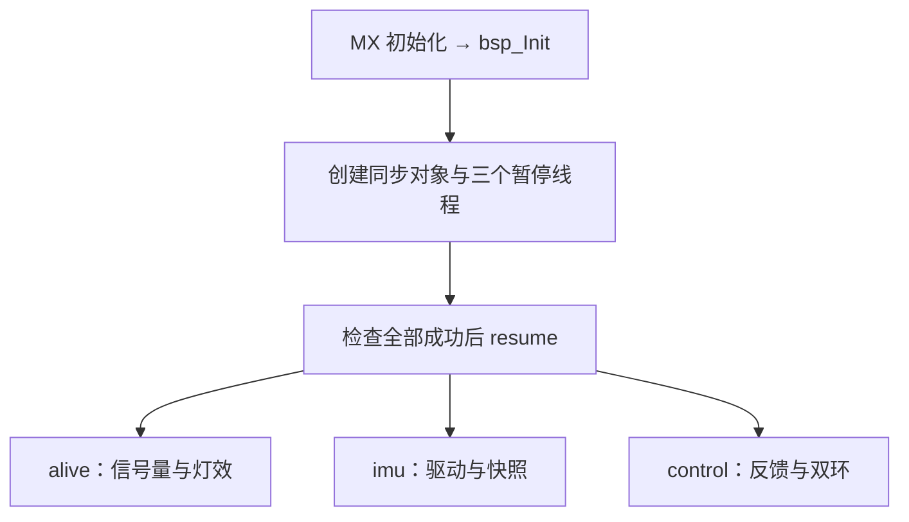

# ThreadX 线程实现与学习说明

适用：STM32F407IGH6 标准 RoboMaster C 板；仓库 `hcyhappy/RM_Framework`。
基线提交：`8d42693d8fb96680d273ad4b13ef32dcd6a23058`。本次完成 alive、imu、control，替换旧 heartbeat 演示。

**默认三个线程都运行；电机默认只接收反馈，不发送控制报文。** 六轴姿态和 IST8310 读取默认打开，可分别关闭。PID 参数保留为零，必须按实际电机台架填写，再打开输出开关并显式使能。没有板子，本次不声称完成硬件验收。

## 1. 文件与调用关系

| 文件 | 职责 |
|---|---|
| `threads/src/app_threadx.cpp` | 创建内存池、互斥锁、信号量、线程；共享 API、周期等待、错误检查 |
| `threads/src/alivethread.cpp` | 消费初始化事件和两个独立心跳，统一控制运行灯效 |
| `threads/src/imuthread.cpp` | BMI088 初始化、重试、采样、温度缓存、可选磁场与六轴解算 |
| `threads/src/controlthread.cpp` | 独占 CAN 队列，注册 M2006，执行双环，处理停机、掉线及发送故障 |
| `threads/include/app_config.hpp` | 电机 CAN/ID、PID/限幅、线程周期等实际应用参数 |
| `threads/include/threads.hpp` | 数据快照、健康状态及安全的线程调用接口 |
| `modules/include/ahrs6.hpp`、`modules/src/ahrs6.cpp` | 与 HAL/ThreadX 无关的六轴姿态算法 |
| `bsp/src/bsp_can.cpp` | 新增取消待发送 CAN 报文的 BSP 接口 |
| `tests/threads/` | 主机异常路径测试、ELF 中断向量检查 |



`main.c` 已在 MX 初始化后调用 `bsp_Init`，成功才进入 `app_threadx_start`；本次沿用这个入口。BSP 初始化失败时，原有 main 点亮红灯并进入 `Error_Handler`，不会进入内核。内核对象创建失败或栈检查报错同样保留红灯并停止执行。

没有修改 `board.ioc`、时钟树、NVIC、HAL 时基、中断适配或第三方 ThreadX 内核。TIM6 仍给 HAL 1 ms 时基，SysTick 仍给 ThreadX 1 ms tick。以后重新生成 CubeMX 代码，仍须保留原有 USER CODE 初始化调用。

## 2. 优先级、栈和 sleep

| 线程 | 优先级 | 独立栈 | 正常周期 | 用途 |
|---|---:|---:|---:|---|
| alive | 4 | 1536 B | 100 ms | 尽快观察普通任务停滞，工作后立即 sleep |
| control | 6 | 3072 B | 2 ms | 单电机控制与反馈 |
| imu | 8 | 4096 B | 2 ms | IMU SPI/I²C 采样与姿态计算 |

ThreadX 数字越小优先级越高。内核定时器线程优先级仍为 0，栈 1024 B。调度采用抢占，三个应用线程的抢占阈值等于自身优先级，均不使用时间片。alive 的优先级高于 control/imu，所以普通任务在 CPU 中卡住时，alive 仍有机会报警；若中断被永久关闭或高优先级 ISR 卡死，软件监控自身也无法继续执行。此版本未增加独立硬件看门狗。

线程栈从静态 **12288 B byte pool** 中分配，共申请 8704 B，剩余供池管理与预留；不使用无边界 `_end` 分配。互斥锁、线程控制块、数据快照另外占 SRAM。MSP/链接脚本的主栈和 C/C++ heap 与线程栈是不同区域，未改原有链接设置。保持 8 字节池起始对齐，并开启既有 `TX_ENABLE_STACK_CHECKING` 与栈错误回调。容量已满足链接，但实际最大栈使用量须在板上测量，不能由编译成功推出。

`AppSleepUntil(deadline, period)` 用绝对 deadline 减少“运行耗时 + 固定 sleep”累计漂移：

1. 下一 deadline 加一个周期；
2. 尚未超时则 sleep 剩余 tick；
3. 已超时则计入 `missedDeadlines`，重置时间参考并 **至少 sleep 1 tick**，不连续追赶旧周期；
4. 使用 32 位差值处理 tick 回绕，所有这里使用的间隔远小于半个计数范围。

`AppTicks(ms)` 向上取整换算 tick。当前 1 tick = 1 ms，但代码不假定每种 ThreadX 工程都是这个值。BMI088/IST8310 驱动内部初始化等待也会在运行线程中调用 `tx_thread_sleep`。所有正常 `for(;;)` 都会阻塞等待；外设 HAL 调用不放在关闭中断的长临界区中。

## 3. alive：用独立信号量监控

创建三个计数信号量，初值均为 0：

| 信号量 | 谁 put | alive 如何 get |
|---|---|---|
| `init_semaphore` | 内核对象创建成功、BMI 初始化状态变化、电机注册完成 | `TX_NO_WAIT` 消费事件，再查看各初始化状态 |
| `imu_semaphore` | imu 主循环进展时 | `TX_NO_WAIT` 消费心跳，记录最近看到心跳的时刻 |
| `control_semaphore` | control 主循环进展时 | 同上，完全独立于 imu 的心跳 |

`tx_semaphore_put` 给计数加一，成功的 `tx_semaphore_get` 消耗一个。不能让两项任务共用一个“存活”信号量，否则一项不停 put 就可能掩盖另一项已死。初始化信号量只表达“状态变了”，究竟谁成功、谁失败以锁保护的 `AppHealth` 为准；它不是“收到一次 put 就代表整个板子正常”。

`AppPulse` 将每个任务的心跳频率限制为 20 ms 一次；alive 每 100 ms 最多消费每个信号量 16 个 token，正常约 5 个，会清空旧心跳。消费端总量足够，并有工作上限，避免监控线程长时间占 CPU。上电有 2000 ms 宽限，之后连续 500 ms 没有对应新心跳就判该任务停滞。

**线程存活与设备正常分开判断：**

- BMI 初始化失败：`imuInit=Failed`，立即红灯；imu 在重试期间仍能上报线程心跳。
- BMI 读失败：`imuDataOk=false`，独立反映；连续 3 次采样失败后转初始化失败，约 1 s 后再尝试配置。
- control 即使没有电机反馈，仍处理队列、更新状态、put 心跳并 sleep。此时是 `AwaitFeedback`，不能把它误写成控制线程死亡。
- 电机使能后掉线、丢失多圈位置连续性、控制循环间隔超过 10 ms、连续 CAN 发送失败等，会进入 `Fault` 并清 PID/输出。
- 可选磁力计失败不会把可正常工作的 BMI088 判死；看 `magneticValid` 与 `magneticMs`。

灯效由 alive 统一写，不让普通 imu/control 线程争抢 GPIO：

| 灯效 | 含义 |
|---|---|
| 蓝灯每秒亮约 200 ms | alive 仍在执行；不等于所有设备都正常 |
| 红绿同步闪烁 | 尚在初始化／等待首批有效 BMI 数据 |
| 绿灯每秒亮约 500 ms | 初始化及线程监控正常，但电机未运行位置控制 |
| 绿灯常亮 | 电机控制状态为 Running |
| 红灯常亮、绿灯灭 | 必需模块初始化失败、数据异常、心跳超时或控制故障 |

蓝灯独立于红绿诊断；红灯时蓝灯仍可能闪。故障退出后灯效随状态恢复；电机故障则仍需要显式重新使能。`app_init_status` 是 ThreadX 对象创建/错误状态，不是 BMI 初始化状态。

## 4. imu：单一驱动所有者与数据共享

只有 imu 线程使用 BMI088 的 SPI1/片选。初始化在内核启动后执行，因此软复位、寄存器配置的等待不会占住 CPU 忙等。默认保留 modules 的 ±6g、±2000°/s 配置，输出已分别换算到 m/s² 和 rad/s；加速度 SPI 读操作中的额外 dummy 字节由模块丢弃，线程不重复处理。

每个采样循环分别读 acc 和 gyro，分别保存返回状态，**两者都成功才发布 `valid=true` 的新数据**。读取失败保留之前的数值并把有效标志置假，不用全零伪装有效测量。温度约每 200 ms 读取并缓存，带自己的有效标志和读取时间。芯片温度寄存器更新约 1.28 s，频繁读寄存器不会加快芯片温度转换。加速度读取的数据结构中的温度字段也不会覆盖缓存温度。

这里用 2 ms 软件轮询；BMI acc 800 Hz、gyro 1000 Hz 的内部采样并不因此同步到 500 Hz。现有 PC4/PC5 是普通输入而非 EXTI，本次不依靠 DRDY，也不宣称每次都是同一时刻的新转换。要进一步提高同步精度，需要单独设计 DRDY/时间戳方案。

共享对象采用 `TX_MUTEX`，启用 `TX_INHERIT` 优先级继承。锁内只复制快照／修改状态，**SPI、I²C、sleep、PID、CAN 发包均在锁外**。继承机制缓解低优先级任务持锁时阻挡高优先级任务的问题；锁范围短更为关键。

应用线程这样读取：

```cpp
#include "threads.hpp"
#include "bsp_time.hpp"

ImuSnapshot imu;
if (GetImuSnapshot(&imu) && imu.valid &&
    uint32_t(BSP_GetTickMs() - imu.sampleMs) < 20) {
    // imu.acceleration: m/s²
    // imu.angularVelocity: rad/s
    // imu.attitude: 四元数及 roll/pitch/yaw；另检查 attitudeValid
}
tx_thread_sleep(AppTicks(10));
```

`GetImuSnapshot` 的 true 表示复制成功，不代表传感器数据有效或新鲜。该接口用 `TX_NO_WAIT`，锁忙时返回 false，下一周期再取。禁止在 ISR 中取快照，也不要直接并发读取调试用的 `app_imu` / `app_health`。`sequence` 仅在完整 acc/gyro 成功采样时递增。

原始加速度、角速度和姿态的“body”当前指 **BMI 原生传感器坐标系**。板子安装到车体后，必须核对实际轴方向；如需车体坐标，在解算前对 acc 和 gyro 应用相同的正交旋转。磁力计原生坐标另行核对，不能直接假定与 BMI 一致。

## 5. IST8310 选做

默认 `RM_ENABLE_IST8310=ON`。imu 线程初始化磁力计，经 BSP I²C1 读取，量纲 µT。模块使用单次转换：触发 → 等待至少 5 ms → 检查 DRDY → 读取 XYZ/状态 → 触发下一次。线程每约 10 ms 尝试一次，`HAL_BUSY` 表示转换未就绪，不当作普通通信错误。

I²C 错误／超过约 100 ms 没得到转换数据会把磁场有效标志清除，再约 1 s 后重新初始化。快照带 `magneticMs`，消费者仍应按自身需求检查数据年龄。BMI 重初始化耗时期间磁场可能暂时变旧，因此时间戳检查不能省略。若不需要磁力计：

```powershell
cmake --preset Debug -DRM_ENABLE_IST8310=OFF
cmake --build --preset Debug
```

本次实现磁场读取，**没有实现九轴融合**；磁场不偷偷影响六轴 yaw。

## 6. 六轴姿态：实现和局限

默认 `RM_ENABLE_AHRS6=ON`。`Ahrs6` 是简化的 Mahony 风格重力比例校正滤波器：只用 gyro 和 acc，Kp=2 s⁻¹、Ki=0，没有在线偏置估计。采用标量在前的单位四元数 $q=(w,x,y,z)$，表示传感器坐标到世界坐标的旋转；欧拉角按 ZYX 提取，单位 rad。

### 6.1 gyro 提供短时间旋转

角速度必须是 rad/s，四元数运动学是：

$$
\dot q=\frac12q\otimes(0,\omega_x,\omega_y,\omega_z)
$$

本实现用实际相邻采样读取时间差计算 dt，欧拉积分一步，再归一化四元数。dt 非有限、≤0、>50 ms 时，算法接口拒绝更新；线程在长间隔／重初始化／采样失败后重新建立姿态参考。重新建立参考会重新置 yaw 基准，不能据此驱动需要连续绝对航向的功能。

### 6.2 acc 提供重力方向约束

加速度计测的是比力，静止且原生 +Z 朝上时读到约 +g。首次用：

$$
\phi=\operatorname{atan2}(a_y,a_z),\qquad
\theta=\operatorname{atan2}(-a_x,\sqrt{a_y^2+a_z^2})
$$

初始化横滚和俯仰，初始航向设为 0。从当前 q 预测传感器坐标中的向上方向：

$$
\hat{\mathbf g}=
\begin{bmatrix}
2(xz-wy)\\2(wx+yz)\\1-2(x^2+y^2)
\end{bmatrix}
$$

归一化加速度 $\hat{\mathbf a}$ 与预测方向做叉积，形成角速度校正：

$$
\mathbf e=\hat{\mathbf a}\times\hat{\mathbf g},\qquad
\boldsymbol\omega_c=\boldsymbol\omega+K_p\mathbf e
$$

把 $\boldsymbol\omega_c$ 代回四元数积分即可。为减轻明显线加速度影响，仅在加速度模长处于 0.8g～1.2g 时使用重力校正，其余情况仅 gyro 积分。**模长门限不能识别所有线加速度**，这个简化滤波器还不是完成动态标定和鲁棒性评估的比赛导航算法。

### 6.3 六轴为什么不能给绝对 yaw

绕重力方向旋转不会改变静止加速度方向，所以 acc 无法观测 yaw。yaw 仍靠 gyro 积分，零偏会导致漂移；Ki=0 也不会自动估计 gyro 偏置。欧拉 yaw 在 ±π 处回绕，俯仰接近 ±90° 时欧拉角存在奇异性；需要连续旋转表示时优先使用四元数，并另外实现航向展开。

本实现未自动调用 `Calibrate`：静止标定必须确保板子真的不动，不能在车已运动时盲目求“零偏”。可在未来增加有明确静止条件的标定状态机和相应心跳宽限。

### 6.4 为什么比赛中常谨慎使用九轴

九轴可利用地磁校正 yaw，但前提是磁场可信。电机磁体、钢件、供电电流和环境磁性物体会造成硬铁／软铁及变化的磁场干扰。恒定安装误差可通过标定减轻，但电流随运动变化、车体位置变化导致的干扰不一定能由一份固定标定消除。盲目融合可能把外部磁干扰当作车体转向，反而使 yaw 跳动。

这是结合磁力计原理与机器人使用环境作出的工程判断，**不是比赛禁止九轴，也不是所有队伍都不用九轴**。需要绝对航向时，可在磁标定、布局和干扰验证后进行磁场门控融合，或引入视觉／其他可靠航向参考。编码器也有滑移误差，替代参考仍需评估。

## 7. control：单电机双环

默认选择 CAN1、C610 ID1，反馈 ID 为 `0x201`，控制分组为 `0x200`。换 CAN 或电机 ID 时只改 `app_config.hpp`。反馈速度与位置均是 **M2006 减速箱输出轴**：rad/s 与相对多圈 rad，不是转子 rpm。

每 2 ms：

1. `PollFeedback` 读取两个 BSP CAN 队列，更新注册电机；
2. `AliveCheck` 判断反馈超时、位置连续性等；
3. 锁内取控制命令，锁外验证使能、PID 配置和电机在线状态；
4. 显式首次使能时 `ZeroPosition`，把当时输出轴角度定义为相对零点；
5. 位置 PID 输出限幅后的目标速度，速度 PID 输出限幅后的 C610 电流命令；
6. handler 打包 CAN，更新健康快照，put 心跳，sleep。

$$
e_p=\theta_{set}-\theta_{fdb},\quad
\omega_{set}=\operatorname{clip}(PID_p(e_p),\pm\omega_{max})
$$

$$
e_v=\omega_{set}-\omega_{fdb},\quad
I_{cmd}=\operatorname{clip}(PID_v(e_v),\pm I_{max})
$$

两环在本训练实现中同周期执行；输出和积分限幅使用既有 PID 类。当前 PID 的 ki/kd 是离散系数，连续参数需换算 $k_i=K_iT_s$、$k_d=K_d/T_s$，这里正常 $T_s=0.002$ s。改线程周期后应重新检查系数；这不是自动根据每次抖动重算连续 PID 的实现。

默认 `CurrentLimit=1000`（C610 命令约 ±1 A），`MaxSpeed=1 rad/s`、`MaxPosition=2π rad`。**这些是约束，不是验证过的 PID 参数**。当前 `SpeedKp/PositionKp` 等仍为 0，`MotorConfigValid` 不允许这种未配置状态解锁。调参从较小输出限制和 P 参数开始，先速度环，再位置环，再考虑积分和微分；实际稳定性、方向和机械负载需台架验证。主机测试用的 P 值仅为算术测试，不能照搬到硬件。

### 7.1 如何实际启用

1. 在 `threads/include/app_config.hpp` 核对 `MotorCanBus`、反馈 ID、超时，以及允许的位置／速度／电流；填写经过台架验证的 PID 参数。配置检查要求增益和限幅为有限非负数，两环 Kp>0，电流≤10000，反馈超时≤50 ms。
2. 打开构建开关：

```powershell
cmake --preset Debug -DRM_ENABLE_MOTOR_OUTPUT=ON
cmake --build --preset Debug
```

3. 等待电机反馈正常，在一个运行线程中显式提交命令：

```cpp
// 放在你的命令处理线程中；不要放在 ISR 或 tx_application_define 中。
// 调用返回 false 时，检查输出开关、PID 配置、注册及在线状态。
bool accepted = SetMotorCommand(true, 0.2f); // 输出轴相对本次使能零点转 0.2 rad
// 后续 true 调用只更新目标，不重新置零。
// 停止：
// SetMotorCommand(false, 0.0f);
```

这段是调用示例，不会在固件中自动执行。当前没有遥控器协议／按键命令层，因此默认不会自行解锁电机。也可以在 control 循环更新健康状态后添加经过你确认的台架命令逻辑，但不要反复执行“失败就自动 disable/enable”，否则会绕过故障锁存设计。

`ZeroPosition` 只是当前角度作为相对零点，不是机械回零，不代表已找到限位。掉线、CAN 丢帧导致多圈位置失效时需要显式 disable → enable，重新核对位置含义；不自动回到旧目标。

### 7.2 故障、发送与总线所有权

控制已使能后，如果反馈超过 50 ms、位置连续性丢失、控制间隔超过 10 ms，或发送发生非 BUSY 错误／连续 5 次 BUSY，则清两环状态、置零并锁存 Fault。没有看到 disable → enable 的新使能代次时，反馈恢复也不重新运行。

停机或故障会通过 `CAN_AbortPending` 请求取消该 CAN 的旧待发送报文；新非零命令必须等到取消完成。连续取消失败同样导致故障。显式停机后在取消完成时提交一次全零报文；使能状态的故障期间会继续尝试零命令。

`HAL_OK` 仅表示 CAN 邮箱接受，并非对方已经执行。取消请求是异步的，`HAL_BUSY` 表示尚未完成；已经发上总线的报文无法撤回。若总线断开、Bus-Off 或接收端断电，软件无法保证零命令送达；ESC 超时保护及独立停机措施仍需实际硬件验证。

本例 control 是 **两个 BSP CAN 接收队列的唯一消费者**。其他协议应接入 `unhandledFrame` 分发，不另开线程竞争读取。取消接口会影响该 CAN 的全部发送邮箱，扩展到更多发送者时须先统一发送所有权。handler 对同组未注册电机槽填零，因此单电机台架不要把同组其他独立控制的电机混接；多电机扩展时统一注册和发包。

control 还周期调用 BSP 的 `USART_Service` 恢复已有 UART DMA 接收错误，不消费 UART 数据，也不在控制周期内进行 printf 或阻塞发送。

## 8. 构建、测试和未验证事项

测试基于真实应用源文件，主机使用 ThreadX/HAL 桩；验证对象创建后才 resume、互斥访问、tick 回绕、心跳 token 过期、LED 逻辑、BMI 成功／读故障、双环计算、显式停机、超时锁存、发送忙、取消未完成、掉线恢复需重使能、四元数积分及重力校正。主机测试不能替代真实抢占调度或 ISR 时序测试。

运行（Linux／WSL／Git Bash，需本机 g++）：

```bash
bash tests/threads/run.sh
bash tests/bsp/run.sh
bash tests/modules/run.sh
ASAN_OPTIONS=detect_leaks=0 bash tests/libs/run.sh
python3 tests/threads/verify_vectors.py build/Debug/board/board.elf
```

默认板级工程内执行 preset 时，ELF 路径是 `build/Debug/board.elf`；从仓库根转发构建时是上例的 `build/Debug/board/board.elf`。

本次使用 Arm GNU 13.2.1 完成根入口 Debug、Release、允许输出但零增益的 Debug、关闭磁力计及 AHRS 的 Debug 构建。检查实际 ELF 的 11 个关键中断向量及未解析符号。保留 ThreadX/板级中断所有权。最终资源数字和测试记录见 `docs/logs.md`。

目前未上板验证：RGB 实际灯效、BMI／IST 通信与安装轴、真实采样间隔和 CPU 占用、栈余量、CAN负载／断线保护、输出轴位置方向及 PID 稳定性。六轴 yaw 仍会漂移；本次未做加热、在线零偏估计、九轴融合、机械回零或遥控命令解析。

## 9. 参考资料

以下用于核对原理与 API；本说明的周期、栈、状态机及默认策略来自本次代码设计。

- [ThreadX 官方用户指南与服务 API](https://github.com/eclipse-threadx/rtos-docs/blob/main/rtos-docs/threadx/chapter4.md)：信号量、线程创建、sleep、互斥锁的使用。
- [固定版本 ThreadX v6.4.2_rel 源码](https://github.com/eclipse-threadx/threadx/tree/v6.4.2_rel)：本工程保持原有内核版本；在线文档可能已更新，编译以仓库固定版本为准。
- [Bosch BMI088 数据手册](https://www.bosch-sensortec.com/media/boschsensortec/downloads/datasheets/bst-bmi088-ds001.pdf)：物理单位、温度转换与芯片时序。
- [Mahony 等，Nonlinear Complementary Filters on the Special Orthogonal Group](https://researchportalplus.anu.edu.au/en/publications/nonlinear-complementary-filters-on-the-special-orthogonal-group/)：姿态互补滤波原理。当前代码是比例重力校正的简化实现，不声称完整复现论文的偏置观测器。
- [NXP AN4246：硬铁与软铁干扰校准](https://www.nxp.com/docs/en/application-note/AN4246.pdf)。
- [NXP：磁力计布局与电流干扰](https://www.nxp.com/company/about-nxp/smarter-world-blog/BL-MAGNETOMETER-PLACEMENT-WHERE-WHY)。
